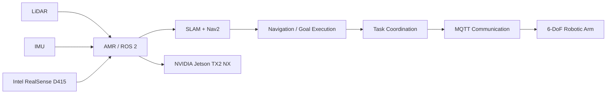

# ROS 2 AMR + Robotic Arm Integration

A robotics integration project focused on coordinating an **Autonomous Mobile Robot (AMR)** with a **6-DoF robotic arm** for flexible warehouse-style manipulation tasks.

This work was developed as part of my Master's thesis at SRH University of Applied Sciences in Berlin. The project combines mobile navigation, sensing, robot communication, embedded computing, and manipulation into one system.

> **Repository status:** Project documentation is being cleaned and organised for public release. Source files, launch/configuration files, and demo material will be added progressively from the original project workspace.

## Project Overview

The goal was to build a modular robotic workflow in which an AMR can navigate through an environment, reach a target location, and coordinate with a robotic arm for manipulation tasks.

The system brought together:

- ROS / ROS 2 based robot software
- Autonomous navigation and SLAM
- LiDAR and depth-camera perception
- TF frame management and costmaps
- NVIDIA Jetson edge computing
- MQTT-based communication with the robotic arm
- Simulation and iterative hardware testing

## System Architecture



The architecture was designed so that navigation, sensing, and manipulation could be tested and debugged independently before being combined into a coordinated workflow.

## Key Engineering Work

- Integrated an AMR and robotic manipulator into a common robotics workflow
- Configured and debugged **Nav2**, **slam_toolbox**, **tf2**, and costmap behaviour
- Worked with `odom`, `base_link`, `laser_frame`, and sensor transforms
- Integrated LiDAR, IMU, and **Intel RealSense D415** sensing
- Used **MQTT** to exchange commands and status information with the robotic arm
- Investigated navigation, transform, communication, and sensor-integration failures
- Validated behaviour through simulation, RViz visualisation, and iterative hardware testing
- Migrated parts of the robotics stack toward **ROS 2 Jazzy** during later development

## Technology Stack

### Robotics
- ROS / ROS 2
- ROS 2 Jazzy
- Nav2
- slam_toolbox
- tf2
- RViz / RViz2
- Gazebo

### Programming & Systems
- C++
- Python
- Ubuntu Linux
- Git
- MQTT

### Hardware
- NVIDIA Jetson TX2 NX
- Intel RealSense D415
- LiDAR
- IMU
- Autonomous Mobile Robot
- 6-DoF robotic arm

## Engineering Challenges

Some of the most useful learning came from debugging integration issues rather than from individual components.

### TF and frame consistency
Navigation required a consistent transform tree between frames such as `odom`, `base_link`, and `laser_frame`. Incorrect or delayed transforms affected localisation and costmap behaviour.

### Navigation configuration
Nav2 and costmap parameters had to be tuned and validated iteratively while checking sensor data, transforms, and robot behaviour in RViz2.

### Sensor integration
LiDAR and depth-camera data had to be validated independently before using them as part of the wider robotic workflow.

### Robot-to-arm communication
MQTT provided a lightweight interface between the mobile robot workflow and the robotic arm, allowing the manipulation side to remain modular.

## What This Project Demonstrates

This project is less about one isolated algorithm and more about **system-level robotics engineering**:

- bringing multiple hardware and software components together
- debugging across communication, sensing, navigation, and control boundaries
- working in Linux and ROS environments
- testing on both simulated and real robotic systems
- iterating when the complete system behaves differently from individual components

## Planned Repository Structure

```text
ros2-amr-robot-arm/
├── README.md
├── docs/
│   ├── ARCHITECTURE.md
│   └── PROJECT_NOTES.md
├── config/
├── launch/
├── src/
└── media/
```

The original project files are currently being reviewed before public upload so that the repository contains only relevant, reproducible material.

## Thesis

**A ROS-Based Approach for Collaborative AMRs and Robotic Arms**  
Master of Engineering, SRH University of Applied Sciences, Berlin  
**Thesis grade: 1.3**

## Current Direction

I am continuing to develop my robotics software skills around:

- ROS 2 deployment and reproducibility
- robot fleet management
- distributed robot systems
- Linux-based robot infrastructure
- Rust for robotics and systems programming
- Pixi and RoboStack

## Author

**Karan Chauhan**  
Robotics Software Engineer  
GitHub: [@karan-automation](https://github.com/karan-automation)  
LinkedIn: [Karan Chauhan](https://www.linkedin.com/in/karan-chauhan-425007212)
