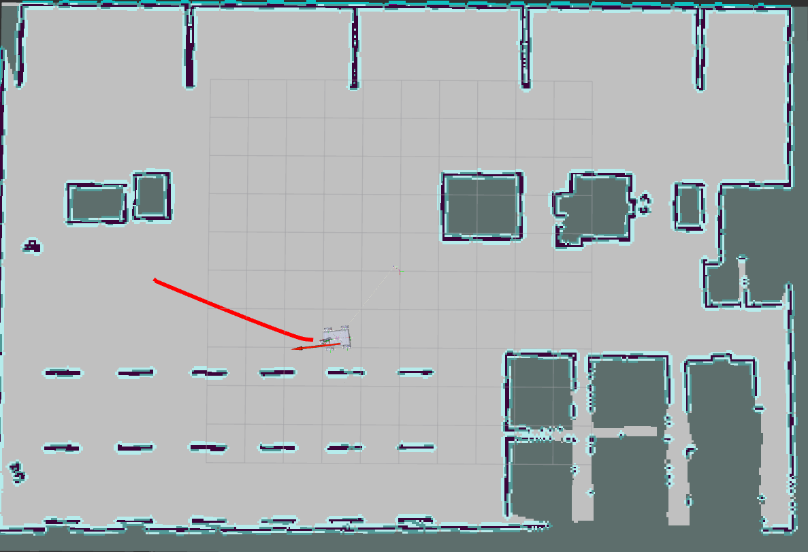
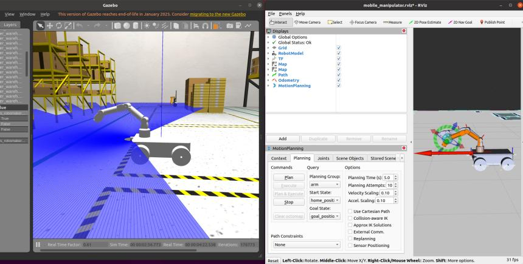
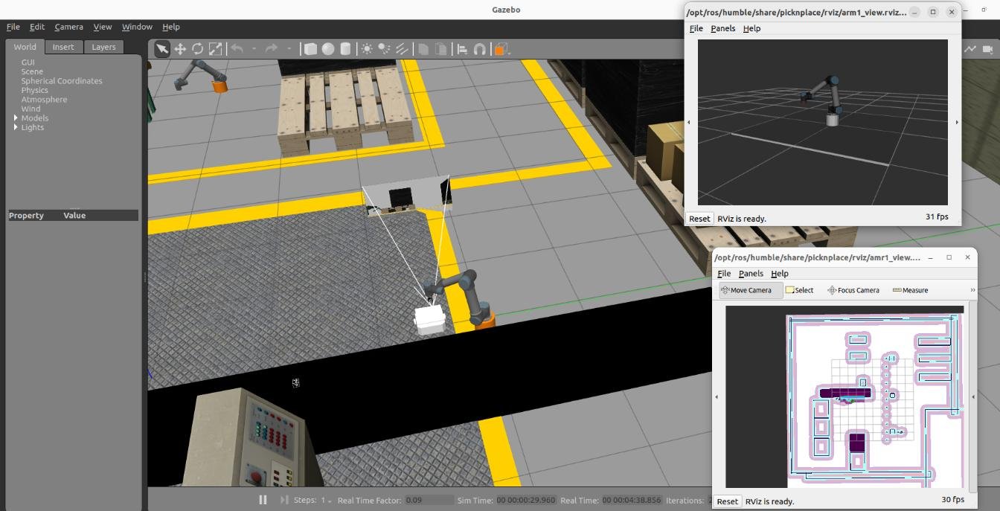
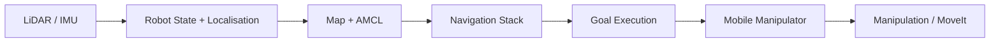

# AMR + Robotic Arm Integration | ROS / ROS 2

A robotics integration project focused on coordinating an **Autonomous Mobile Robot (AMR)** with a robotic manipulator for warehouse-style navigation and manipulation tasks.

This repository is based on work from my Master's thesis at SRH University of Applied Sciences in Berlin. The project was implemented primarily in **ROS 1 Noetic**, with selected **ROS 2 Humble** examples used to demonstrate comparable navigation and manipulation concepts.

> **Repository status:** I am curating the original project workspace for public release. Only project-specific files and clearly attributed material are included.

## Project Overview

The project explores how mobile navigation and robotic manipulation can be combined in one workflow:

1. Navigate the mobile robot through a warehouse-style environment
2. Localise using map and LiDAR data
3. Plan and execute navigation goals
4. Coordinate navigation with robotic-arm manipulation
5. Test and debug the complete system in Gazebo and RViz

## Visual Evidence

### Navigation and localisation in RViz


*Figure from the thesis showing a 2D navigation goal and the mobile robot's navigation state in RViz.*

### Robotic-arm motion planning with MoveIt


*Figure from the thesis showing the manipulator moving toward a configured goal pose using MoveIt.*

### ROS 2 Humble demonstration


*Figure from the thesis showing the ROS 2 Humble pick-and-place demonstration used for comparison with the ROS Noetic workflow.*

## What I Worked On

- Configured a mobile manipulator in **Gazebo**
- Set up **AMCL localisation** and the ROS navigation stack
- Tuned global and local costmap parameters
- Worked with LiDAR and IMU simulation interfaces
- Configured robot frames and transforms
- Used **MoveIt** for robotic-arm motion planning and manipulation experiments
- Tested goal execution and navigation in a warehouse-style simulation
- Investigated navigation, localisation, transform, controller, and integration issues
- Explored a later **ROS 2 Humble** setup using Nav2, lifecycle-managed nodes, ros2_control, and MoveIt 2 concepts

## Technology Stack

### Robotics
- ROS 1 Noetic
- ROS 2 Humble
- Gazebo
- RViz / RViz2
- MoveIt / MoveIt 2
- AMCL
- move_base
- Nav2 concepts
- TF
- costmap_2d

### Programming & Systems
- C++
- Python
- Ubuntu Linux
- Git

### Robot & Sensor Interfaces
- LiDAR
- IMU
- Differential-drive mobile base
- 6-DoF robotic manipulator
- ROS controllers

## System Flow



The project was developed iteratively, with navigation and manipulation tested independently before being combined into the same simulated warehouse workflow.

## Original Project Evidence

The retained project workspace contains:

- ROS launch files for navigation and simulation
- costmap and local-planner configuration
- AMCL configuration
- URDF models for the mobile manipulator
- MoveIt configuration
- Gazebo warehouse environment
- saved maps and RViz configuration
- local navigation and manipulation demonstration recordings

A separate ROS 2 Humble example was also used to compare navigation, lifecycle management, control, and manipulation concepts with the primary ROS Noetic workflow.

## Engineering Challenges

### Localisation and navigation
AMCL, map configuration, sensor data, and coordinate frames had to remain consistent for reliable navigation.

### Costmap tuning
Obstacle range, ray-tracing range, robot footprint, inflation radius, and local/global costmap behaviour were tuned for the simulated mobile platform.

### TF and robot frames
Transform relationships between the map, odometry, base, laser, and manipulator frames were important for localisation, planning, and visualisation.

### Manipulation
MoveIt was configured for kinematics, collision checking, trajectory planning, and goal-pose testing inside the mobile-manipulator simulation.

### System-level debugging
The main engineering challenge was debugging interactions between navigation, sensing, controllers, transforms, and manipulation rather than treating each subsystem separately.

## Repository Structure

```text
amr-robot-arm-integration/
├── README.md
├── docs/
│   ├── ARCHITECTURE.md
│   ├── PROJECT_NOTES.md
│   └── ATTRIBUTION.md
├── ros1_simulation/
│   ├── launch/
│   └── config/
└── media/
```

## Source & Attribution

The original workspace also contained third-party ROS packages and tutorial material. I am intentionally **not publishing third-party code as my own work**.

See [docs/ATTRIBUTION.md](docs/ATTRIBUTION.md) for details.

## Thesis

**A ROS-Based Approach for Collaborative AMRs and Robotic Arms**  
Master of Engineering, SRH University of Applied Sciences, Berlin  
**Thesis grade: 1.3**

## Current Direction

I am continuing to develop my robotics software skills around:

- ROS 2
- robot fleet management
- distributed and networked robot systems
- reproducible robot software environments
- Rust for robotics and systems programming
- Pixi and RoboStack

## Author

**Karan Chauhan**  
Robotics Software Engineer  
GitHub: [@karan-automation](https://github.com/karan-automation)  
LinkedIn: [Karan Chauhan](https://www.linkedin.com/in/karan-chauhan-425007212)
