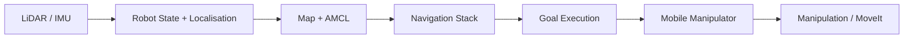

# AMR + Robotic Arm Integration | ROS / ROS 2

A robotics integration project focused on coordinating an **Autonomous Mobile Robot (AMR)** with a robotic manipulator for warehouse-style navigation and manipulation tasks.

This repository is based on work from my Master's project at SRH University of Applied Sciences in Berlin. The original project material includes a **ROS 1 Noetic** mobile-manipulator simulation and later **ROS 2 Humble** navigation experiments.

> **Repository status:** I am cleaning the original project workspace before publishing it. Only project-specific files and clearly attributed material will be added.

## Project Overview

The project explores how mobile navigation and robotic manipulation can be combined in one workflow:

1. Navigate the mobile robot through a warehouse-style environment
2. Localise using map and laser data
3. Plan and execute goals
4. Coordinate navigation with robotic-arm manipulation
5. Test and debug the complete system in Gazebo and RViz

## What I Worked On

- Configured a mobile manipulator in **Gazebo**
- Set up **AMCL localisation** and the ROS navigation stack
- Tuned global and local costmap parameters
- Worked with LiDAR and IMU simulation interfaces
- Configured robot frames and transforms
- Used **MoveIt** for robotic-arm motion planning and manipulation experiments
- Tested goal execution and navigation in a warehouse-style simulation
- Investigated navigation, localisation, transform, controller, and integration issues
- Explored a later **ROS 2 Humble** navigation setup using lifecycle-managed nodes

## Technology Stack

### Robotics
- ROS 1 Noetic
- ROS 2 Humble
- Gazebo
- RViz / RViz2
- MoveIt
- AMCL
- move_base
- TF
- costmap_2d

### Programming & Systems
- C++
- Python
- Ubuntu Linux
- Git

### Robot & Sensor Interfaces
- LiDAR
- IMU
- Mobile robot base
- Robotic manipulator
- ROS controllers

## System Flow



The project was developed iteratively, with navigation and manipulation tested independently before being combined in the same simulated environment.

## Original Project Evidence

The retained project workspace contains:

- ROS launch files for navigation and simulation
- costmap and local-planner configuration
- AMCL configuration
- URDF models for the mobile manipulator
- MoveIt configuration
- Gazebo warehouse environment
- saved maps and RViz configuration
- navigation and manipulation demonstration videos

A separate ROS 2 Humble demonstration also shows map-server lifecycle management and navigation in a warehouse environment.

## Demo Material

I retained four project demonstrations:

- **Setup and Navigation**: Gazebo + RViz navigation setup
- **Send Goal Node**: goal selection and mobile robot navigation
- **Manipulation**: MoveIt-based robotic-arm motion planning
- **ROS 2 Example**: ROS 2 Humble navigation/lifecycle demonstration

Selected screenshots will be added to the repository alongside the cleaned project files.

## Engineering Challenges

### Localisation and navigation
AMCL, map configuration, sensor data, and coordinate frames had to stay consistent for reliable navigation.

### Costmap tuning
Obstacle range, ray-tracing range, robot footprint, inflation radius, and local/global costmap behaviour were tuned for the simulated mobile platform.

### TF and robot frames
Transform relationships between the map, odometry, base, laser, and other robot frames were important for localisation and planning.

### Manipulation
MoveIt was used to configure and test robotic-arm planning inside the mobile-manipulator simulation.

### System-level debugging
The main learning came from debugging interactions between navigation, sensing, controllers, transforms, and manipulation rather than treating each subsystem separately.

## Repository Structure

```text
ros2-amr-robot-arm/
├── README.md
├── docs/
│   ├── ARCHITECTURE.md
│   ├── PROJECT_NOTES.md
│   └── ATTRIBUTION.md
├── ros1_simulation/
│   ├── launch/
│   └── config/
└── media/
```

## Source & Attribution

The original workspace also contained third-party ROS packages and tutorial material. I am intentionally **not publishing third-party code as my own work**.

See [docs/ATTRIBUTION.md](docs/ATTRIBUTION.md) for details.

## Thesis

**A ROS-Based Approach for Collaborative AMRs and Robotic Arms**  
Master of Engineering, SRH University of Applied Sciences, Berlin  
**Thesis grade: 1.3**

## Current Direction

I am continuing to develop my robotics software skills around:

- ROS 2
- robot fleet management
- distributed and networked robot systems
- reproducible robot software environments
- Rust for robotics and systems programming
- Pixi and RoboStack

## Author

**Karan Chauhan**  
Robotics Software Engineer  
GitHub: [@karan-automation](https://github.com/karan-automation)  
LinkedIn: [Karan Chauhan](https://www.linkedin.com/in/karan-chauhan-425007212)
