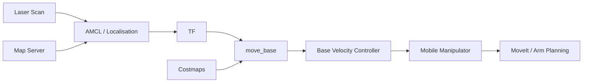

# Architecture

## Navigation and manipulation flow

The retained project workspace uses a ROS 1 Noetic simulation for the mobile-manipulator workflow.

## Main interfaces

| Interface | Purpose |
| --- | --- |
| LaserScan | Obstacle sensing and localisation input |
| IMU | Motion/orientation sensing in simulation |
| Map Server | Publishes the saved environment map |
| AMCL | Particle-filter localisation |
| TF | Coordinate-frame relationships |
| move_base | Goal-based mobile navigation |
| costmap_2d | Global/local obstacle representation |
| MoveIt | Robotic-arm planning and manipulation |
| Gazebo | Robot and environment simulation |
| RViz | Navigation and planning visualisation |

## ROS 2 experiment

A later demonstration uses **ROS 2 Humble** and lifecycle-managed navigation components. It is documented separately from the original ROS 1 simulation so the two development stages remain clear.

More implementation detail will be added as the original workspace is curated for public release.
